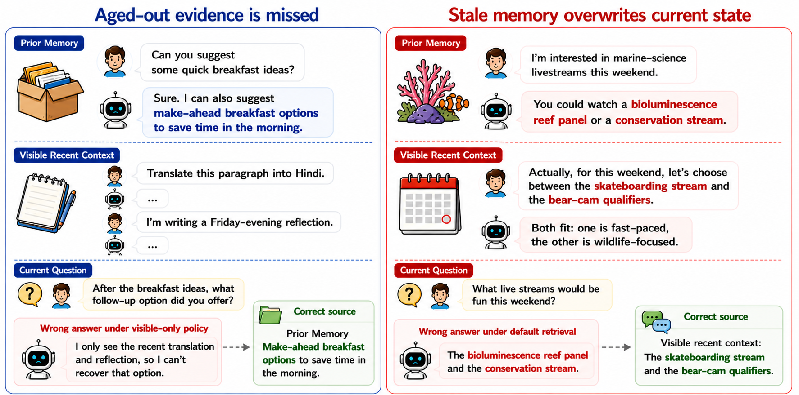
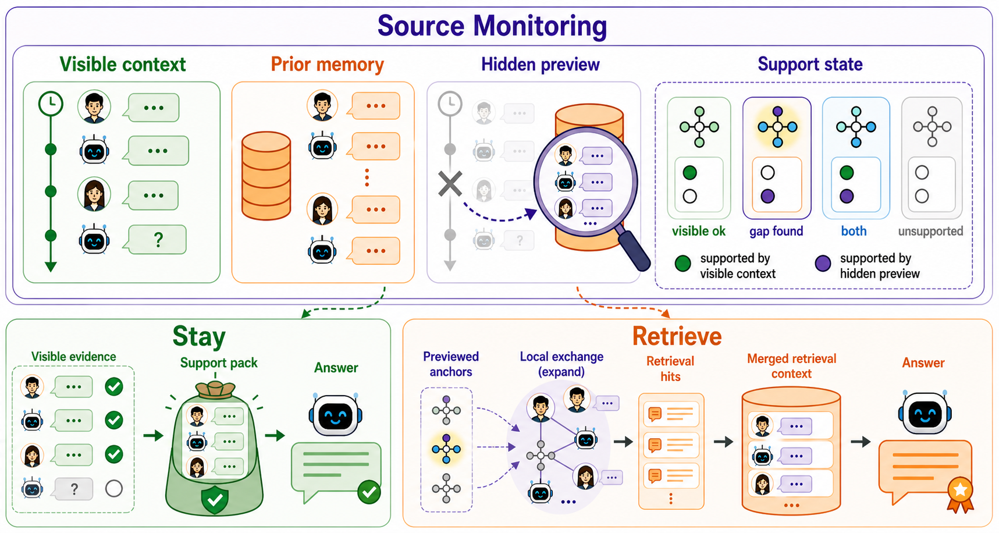
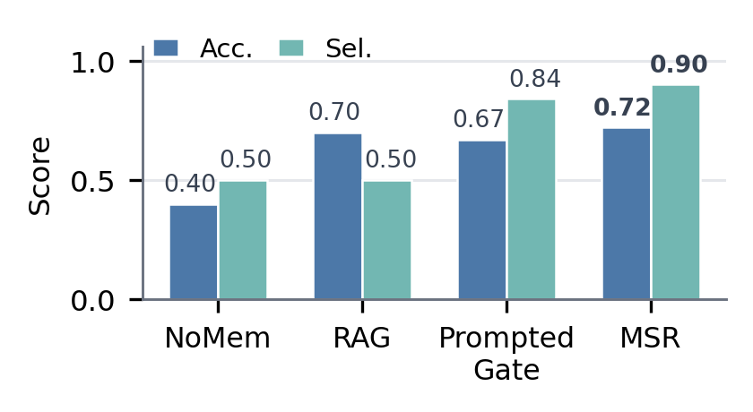
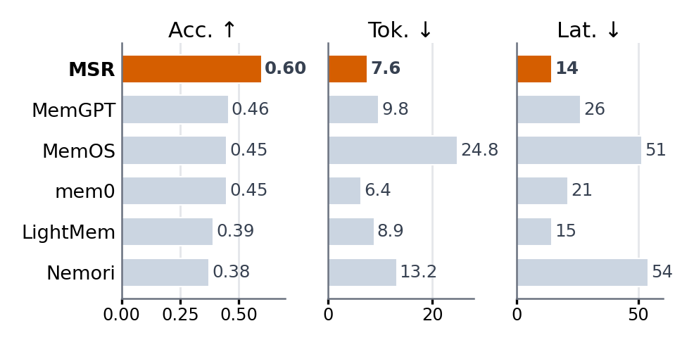

<h1 align="center">Know Where You Stand</h1>
<h3 align="center">Memory-Source Choice in Long-Context Dialogue Agents</h3>

<p align="center"><b>NeurIPS 2026</b></p>

<p align="center"><a href="README.md">English</a> · <b>简体中文</b></p>

<p align="center">
  Caishen Zhou · Yihong Tang · Xuefeng Bai · Kehai Chen · Min Zhang<br>
  哈尔滨工业大学（深圳）
</p>

<p align="center">
  <a href="#msbench"><b>评测基准</b></a> &nbsp;·&nbsp;
  <a href="#msr"><b>方法介绍</b></a> &nbsp;·&nbsp;
  <a href="#results"><b>实验结果</b></a> &nbsp;·&nbsp;
  <a href="#release"><b>代码与数据</b></a> &nbsp;·&nbsp;
  <a href="#citation"><b>引用</b></a>
</p>

<p align="center"><b>对话智能体何时应依赖近期上下文，何时应检索既往记忆？</b></p>

---

## 核心问题

长上下文智能体面临两类相反的错误：一类是遗漏已经移出可见窗口的证据，另一类是引入过时记忆，覆盖当前对话中的有效信息。关键在于判断：**应该依据哪个来源回答当前问题？**

我们提出了专门评测来源选择的基准 **MSBench**，以及无需训练的 **MSR（Memory-Source Reasoner）**。MSR 先判断不同来源是否支持回答所需的信息，再选择来源并组织回答证据。

<p align="center">
  
</p>
<p align="center"><sub>该检索时未检索，以及不需要时引入记忆，都可能导致错误回答。</sub></p>

<a id="msbench"></a>

## MSBench：评测来源选择

MSBench 按时间顺序回放多会话对话。在每个检查点，两道问题共享相同的对话状态，但分别需要不同来源的证据：一道依赖**可见的近期上下文**，另一道需要**既往记忆**。

| 场景 | 回放检查点 | 问题 | 来源分布 |
| :---: | :---: | :---: | :---: |
| **45** | **450** | **900** | **近期上下文与既往记忆各 450 道** |

- **明确来源边界。** 最近 16 轮对话构成可见上下文，更早的轮次构成既往记忆，未来轮次不可见。
- **同状态配对比较。** 在同一检查点，通过需要不同来源的问题检验智能体能否按需选择证据。
- **动态对话状态。** 基准包含状态更新和具有误导性的近期上下文，仅凭主题相关性无法确定正确来源。

我们报告两项指标：**回答准确率**衡量答案是否正确，**选择准确率**衡量是否选中所需的证据来源。MSBench 基于 PersonaMem-v2 构建，迁移实验进一步在其他语料上检验方法。

<a id="msr"></a>

## MSR：先判断证据支持，再选择来源

<p align="center">
  
</p>

1. **监控证据支持。** 将问题拆解为正确回答需要满足的事实与约束，在可见上下文和小规模隐藏记忆预览中定位对应的支持轮次。
2. **选择证据来源。** 当预览提供了可见上下文缺失的支持时，选择既往记忆；否则保留可见上下文。
3. **组织回答证据。** 根据同一支持状态组织所选来源中的证据。在既往记忆分支，恢复相关的局部对话，并将其置于按问题相关性检索的结果之前。

隐藏预览用于来源判断，不直接传给回答模型。MSR 使用同一个骨干模型完成两次调用，**无需微调，也不改变模型架构**。

<a id="results"></a>

## 实验结果

### MSBench 主实验

在 GPT-5-mini 上，MSR 的**回答准确率为 60.0%，选择准确率为 81.7%**，分别比各项指标上最强的非 MSR 基线提高 **12.6** 和 **6.3 个百分点**。

| 方法 | 回答准确率 | 选择准确率 |
| :--- | ---: | ---: |
| No Memory | 28.0 | 50.0 |
| RAG | 47.4 | 50.0 |
| Prompted LLM Retrieval Gate | 46.8 | 75.4 |
| **MSR** | **60.0** | **81.7** |

表中数值均为百分比。在相同的 MSBench 协议下，MSR 在 Gemini 3.1 Flash-Lite、Qwen3 235B-A22B 和 DeepSeek V4 Pro 上也均取得两项指标的最高点估计。

### 跨语料迁移与效率

<table>
  <tr>
    <th align="center">LongMemEval-M 迁移评测</th>
    <th align="center">记忆系统参考比较</th>
  </tr>
  <tr>
    <td width="50%"></td>
    <td width="50%"></td>
  </tr>
</table>

左图在 LongMemEval-M 上沿用 MSBench 的可见上下文与既往记忆边界；右图报告各记忆系统在各自配置下的 MSBench 结果。

在 **LoCoMo 和 QMSum 的来源选择评测**中，MSR 同样取得最高的回答准确率和选择准确率。在受控成本比较中，其每题时延与提示式门控接近。**拒答扩展**则改善了不可回答问题上的动作决策，同时保持对可回答问题的响应。

<a id="release"></a>

## 代码与数据

**代码与数据即将发布。** 计划开放 MSBench 数据、MSR 与基线实现、提示词和评测脚本，并在发布时提供安装与快速开始说明。

<a id="citation"></a>

## 引用

如在研究中使用 MSBench 或 MSR，可暂用以下引用。核实官方书目记录后，我们会更新此条目。

```bibtex
@inproceedings{zhou2026know,
  title     = {Know Where You Stand: Memory-Source Choice in Long-Context Dialogue Agents},
  author    = {Zhou, Caishen and Tang, Yihong and Bai, Xuefeng and Chen, Kehai and Zhang, Min},
  booktitle = {Advances in Neural Information Processing Systems},
  year      = {2026},
  note      = {Accepted to NeurIPS 2026}
}
```

## 许可与数据来源

原创代码将采用 [Apache License 2.0](LICENSE) 发布，允许在遵守条款的前提下用于商业用途。该代码许可证不覆盖论文或数据集；第三方代码和数据仍适用各自的许可证。

**MSBench 基于 Bowen Jiang 及其合作者发布的 [PersonaMem-v2](https://huggingface.co/datasets/bowen-upenn/PersonaMem-v2) 构建，该数据集采用 [CC BY 4.0](https://creativecommons.org/licenses/by/4.0/) 许可。** 我们在原始资源上筛选对话场景、构建按时间顺序回放的检查点，并新增配对的来源选择问题、来源标签和参考答案。发布数据时将一并提供来源版本、署名及适用的许可声明。

迁移实验使用的外部基准分别适用以下上游许可：

| 资源 | 上游许可 |
| :--- | :--- |
| [LongMemEval](https://huggingface.co/datasets/xiaowu0162/longmemeval-cleaned) | [MIT](https://github.com/xiaowu0162/LongMemEval/blob/main/LICENSE) |
| [LoCoMo](https://github.com/snap-research/locomo) | [CC BY-NC 4.0](https://github.com/snap-research/locomo/blob/main/LICENSE.txt)，包含非商业用途限制 |
| [QMSum](https://github.com/Yale-LILY/QMSum) | 官方仓库标注为 [MIT](https://github.com/Yale-LILY/QMSum/blob/main/LICENSE) |

再分发第三方材料时，须保留其要求的署名与许可声明；修改后的材料也须遵守相应上游条款。我们的代码许可证不改变外部数据集的许可。

## 致谢

感谢 [PersonaMem-v2](https://huggingface.co/datasets/bowen-upenn/PersonaMem-v2) 团队提供 MSBench 的基础资源，以及 [LongMemEval](https://github.com/xiaowu0162/LongMemEval)、[LoCoMo](https://github.com/snap-research/locomo) 和 [QMSum](https://github.com/Yale-LILY/QMSum) 团队提供迁移评测所用的基准。
